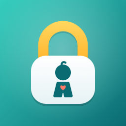

KidLock lets parents hand their iPhone to a young child without handing over the controls: FaceTime calls stay
connected, videos keep playing, and little fingers stay out of everything else.

- [Privacy policy](privacy-policy.html)
- Support: TestFlight testers can write to us from TestFlight → KidLock → Send Beta Feedback.

KidLock is made by Prosperity Simplified. It has no account, no ads and no tracking, and it collects no data.
